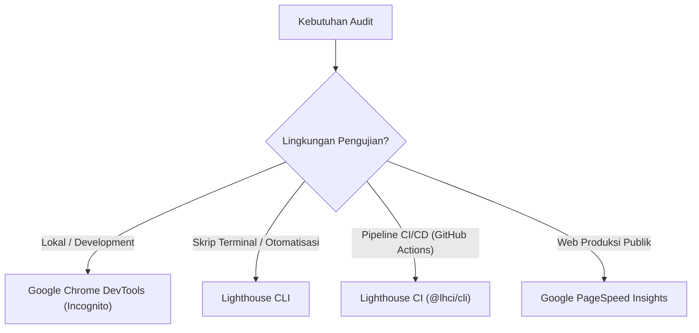
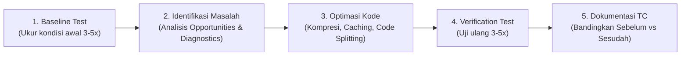

# Panduan Lengkap Penggunaan Google Lighthouse & Rancangan Test Case (TC) Performa Web

Dokumen ini menyajikan panduan menyeluruh mengenai **Google Lighthouse**, mulai dari konsep fundamental, metrik teknis, metode eksekusi, metodologi pengujian performa, hingga template *Test Case* (TC) standar untuk kebutuhan laporan proyek, pengujian perangkat lunak, maupun skripsi/capstone.

---

## 1. Konsep Dasar Google Lighthouse

### 1.1 Apa itu Google Lighthouse?
Google Lighthouse adalah alat audit otomatis (*open-source*) untuk menganalisis kualitas halaman web dari sisi klien (*client-side*). Lighthouse mengevaluasi 5 aspek utama:
1. **Performance (Performa / Kecepatan)**
2. **Accessibility (Aksesibilitas)**
3. **Best Practices (Praktik Terbaik & Standar Web Modern)**
4. **SEO (Search Engine Optimization)**
5. **PWA (Progressive Web App - opsional)**

### 1.2 Apakah Lighthouse Otomatis Meningkatkan Performa?
**Bukan secara otomatis.** Lighthouse bertindak sebagai **alat diagnosis klinis**, bukan perbaikan otomatis:
* Lighthouse menganalisis halaman web, mendeteksi sumber perlambatan (*bottleneck*), dan menyusun rekomendasi teknis yang terukur.
* Pengembang (*developer*) yang mengimplementasikan rekomendasi tersebut ke dalam kode sumber (misalnya mengompres gambar, memisahkan bundle JavaScript, menunda CSS non-kritis).
* Hasil optimasi kode inilah yang meningkatkan performa aplikasi secara nyata.

### 1.3 Pengaruh Hasil Audit terhadap Pengguna di Perangkat Lain
Pengaruhnya **sangat signifikan**. Saat menjalankan audit dalam mode *Mobile*, Lighthouse menerapkan:
* **CPU Throttling (Simulasi perlambatan CPU 4x):** Meniru kemampuan komputasi ponsel kelas menengah ke bawah (*low-to-mid range smartphone*).
* **Network Throttling (Simulasi jaringan seluler lambat / Slow 4G):** Menguji ketahanan web pada latensi tinggi dan bandwidth terbatas.

> [!NOTE]
> Jika sebuah website memperoleh skor performa tinggi di Lighthouse mode *Mobile*, halaman tersebut dipastikan akan terasa ringan, stabil, dan cepat dibuka oleh pengguna dengan perangkat apa pun, termasuk perangkat berspesifikasi rendah dan koneksi internet yang terbatas.

---

## 2. Kategori Audit & Metrik Core Web Vitals

### 2.1 Kategori Audit

| Kategori | Deskripsi Singkat | Target Nilai |
| :--- | :--- | :---: |
| **Performance** | Mengukur kecepatan pemuatan aset, waktu hingga interaktif, dan stabilitas visual. | $\ge 85 - 90$ |
| **Accessibility** | Memastikan elemen UI dapat digunakan oleh disabilitas (screen reader, kontras warna, ARIA). | $\ge 90$ |
| **Best Practices** | Kepatuhan keamanan web modern (HTTPS, no console errors, safe libraries). | $\ge 90$ |
| **SEO** | Kelengkapan metadata agar dapat diindeks secara tepat oleh mesin pencari. | $\ge 90$ |

---

### 2.2 Metrik Kunci Performa (*Core Web Vitals*)

```
Timeline Pemuatan Halaman:
[ Navigasi Dimulai ] ──> [ FCP ] ──────────> [ LCP ] ─────────────> [ Interaktif Penuh ]
                           │                   │                           │
                   Elemen pertama       Elemen terbesar             Thread bebas dari
                     muncul di            muncul di                blocking JavaScript
                       layar                layar                         (TBT)
```

1. **FCP (*First Contentful Paint*):**
   * Waktu saat browser pertama kali merender teks, gambar, atau elemen canvas pertama.
   * *Ambang batas:* Baik ($\le 1.8\text{ detik}$), Cukup ($1.8\text{ s} - 3.0\text{ s}$), Buruk ($> 3.0\text{ s}$).
2. **LCP (*Largest Contentful Paint*) — [Core Web Vital]:**
   * Waktu yang dibutuhkan untuk merender blok konten atau gambar terbesar di area tampilan (*viewport*).
   * *Ambang batas:* Baik ($\le 2.5\text{ detik}$), Cukup ($2.5\text{ s} - 4.0\text{ s}$), Buruk ($> 4.0\text{ s}$).
3. **TBT (*Total Blocking Time*):**
   * Total durasi antara FCP dan *Time to Interactive* di mana eksekusi JavaScript pada *main thread* melampaui $50\text{ ms}$.
   * *Ambang batas:* Baik ($\le 200\text{ ms}$), Cukup ($200\text{ ms} - 600\text{ ms}$), Buruk ($> 600\text{ ms}$).
4. **CLS (*Cumulative Layout Shift*) — [Core Web Vital]:**
   * Mengukur akumulasi pergeseran layout visual yang tidak terduga saat elemen termuat.
   * *Ambang batas:* Baik ($\le 0.1$), Cukup ($0.1 - 0.25$), Buruk ($> 0.25$).
5. **Speed Index:**
   * Seberapa cepat konten halaman terisi secara visual selama pemuatan.
   * *Ambang batas:* Baik ($\le 3.4\text{ detik}$).

---

## 3. Metode Penggunaan Lighthouse



### Metode 1: Google Chrome DevTools (Rekomendasi Utama)
1. Buka browser **Google Chrome**.
2. Masuk ke **Mode Penyamaran / Incognito Window** (`Ctrl + Shift + N` di Windows / Linux).
   > [!IMPORTANT]
   > Mode Incognito wajib digunakan agar ekstensi browser (seperti AdBlocker atau ekstensi password) tidak membebani eksekusi thread dan merusak akurasi skor.
3. Akses URL aplikasi web target.
4. Buka DevTools (`F12` atau `Ctrl + Shift + I`), lalu pilih tab **Lighthouse**.
5. Tentukan konfigurasi:
   * **Mode:** `Navigation (Default)`
   * **Device:** `Mobile` (prioritas utama) atau `Desktop`
   * **Categories:** Centang seluruh kategori yang ingin diuji.
6. Klik tombol **Analyze page load**.
7. Tunggu hingga laporan selesai dibuat.

---

### Metode 2: Lighthouse CLI (Command Line Interface)
Metode ini ideal untuk menjalankan audit otomatis dari terminal atau mengekspor hasil ke format JSON dan HTML.

1. **Instalasi Paket:**
   ```bash
   npm install -g lighthouse
   ```
2. **Eksekusi Audit Standar:**
   ```bash
   lighthouse https://example.com --view
   ```
3. **Eksekusi dengan Output HTML dan JSON:**
   ```bash
   lighthouse https://example.com --output html,json --output-path ./audit-report
   ```
4. **Eksekusi Mode Desktop:**
   ```bash
   lighthouse https://example.com --preset=desktop --view
   ```

---

### Metode 3: Integrasi Otomatis CI/CD (Lighthouse CI)
Digunakan dalam alur continuous integration untuk mendeteksi penurunan performa (*performance regression*).

1. **Install dependensi:**
   ```bash
   npm install -D @lhci/cli
   ```
2. **Buat file `lighthouserc.json`:**
   ```json
   {
     "ci": {
       "collect": {
         "staticDistDir": "./dist",
         "numberOfRuns": 3
       },
       "assert": {
         "assertions": {
           "categories:performance": ["error", {"minScore": 0.85}],
           "categories:accessibility": ["error", {"minScore": 0.90}],
           "first-contentful-paint": ["warn", {"maxNumericValue": 2000}]
         }
       }
     }
   }
   ```
3. **Jalankan:**
   ```bash
   npx lhci autorun
   ```

---

### Metode 4: Google PageSpeed Insights (Web Service)
* Akses melalui tautan resmi: [PageSpeed Insights](https://pagespeed.web.dev/)
* Menggunakan infrastruktur cloud Google untuk menguji URL publik.
* Menyertakan data riil pengguna (*field data / Chrome User Experience Report - CrUX*).

---

## 4. Metodologi Pengujian Performa untuk Test Case (TC)

### 4.1 Mengapa Tidak Boleh Hanya Sekali Tes?
Performa komputasi dan latensi jaringan lokal bersifat dinamis. Pengujian tunggal dapat menghasilkan anomali (misalnya skor tiba-tiba turun karena ada proses background pada sistem operasi).
* **Praktik Standar:** Lakukan audit **minimal 3 hingga 5 kali pengulangan** pada halaman yang sama.
* **Metode Agregasi:** Ambil nilai **median** atau **rata-rata (*average*)** dari seluruh siklus pengujian.

---

### 4.2 Alur Kerja Pengujian & Dokumentasi Performa



1. **Baseline Testing (Pengujian Dasar):**
   * Audit kondisi aplikasi sebelum optimasi.
   * Dokumentasikan skor awal dan metrik spesifik (LCP, CLS, TBT).
2. **Analisis Rekomendasi:**
   * Tinjau panel *Opportunities* dan *Diagnostics* dari Lighthouse.
3. **Implementasi Optimasi:**
   * Terapkan solusi teknis sesuai kebutuhan.
4. **Verification Testing (Pengujian Verifikasi):**
   * Lakukan pengujian ulang (3–5 kali) pada build produksi (*production build*).
5. **Pencatatan Dokumen TC:**
   * Hitung selisih peningkatan performa.

---

## 5. Template & Contoh Test Case (TC) Performa Web

Berikut adalah struktur dokumen pengujian resmi yang dapat disesuaikan untuk kebutuhan laporan proyek atau skripsi:

### Template Test Case Performa

```markdown
| Parameter | Spesifikasi |
| :--- | :--- |
| **Kode Test Case** | TC-PERF-[NO] |
| **Nama Modul / Halaman** | [Nama Halaman yang diuji] |
| **Deskripsi Pengujian** | Mengukur performa client-side dan Core Web Vitals |
| **Alat Pengujian** | Google Lighthouse (Chrome DevTools / CLI) |
| **Environment / Setup** | Device: [Mobile / Desktop], Throttling: [Default / Slow 4G], Browser: Chrome Incognito |
| **Jumlah Iterasi (Run)** | 3 kali pengulangan |
| **Kriteria Keberhasilan** | 1. Skor Performance >= [Target Score]<br>2. LCP <= [Target Detik]<br>3. CLS <= 0.1<br>4. Accessibility >= [Target Score] |
```

---

### Contoh Implementasi Nyata: TC Halaman Utama & Simulasi Kuis

#### Test Case 1: Halaman Simulasi / Kuis (Mode Mobile)

| Atribut Test Case | Keterangan Uji |
| :--- | :--- |
| **ID Test Case** | **TC-PERF-01** |
| **Fitur / Halaman** | Halaman Simulasi Kuis & Diagnostik (`/simulation/quiz`) |
| **Tujuan Pengujian** | Memverifikasi bahwa halaman kuis tetap responsif dan cepat dimuat pada perangkat seluler. |
| **Alat Uji** | Google Lighthouse (Chrome DevTools - Incognito Mode) |
| **Konfigurasi Lingkungan** | Device: **Mobile**, Network: Simulated Slow 4G, CPU: 4x Slowdown, Production Build (`npm run build && serve`) |
| **Langkah-Langkah Pengujian** | 1. Buka browser Chrome dalam mode Incognito.<br>2. Akses URL halaman simulasi kuis.<br>3. Buka tab Lighthouse pada DevTools.<br>4. Pilih opsi **Mobile** dan centang kategori **Performance, Accessibility, Best Practices**.<br>5. Klik **Analyze page load** sebanyak 3 kali secara berkala.<br>6. Rekam skor metrik tiap iterasi dan hitung rata-ratanya. |
| **Kriteria Penerimaan (*Expected Result*)** | - Skor Performance rata-rata $\ge 85$<br>- Largest Contentful Paint (LCP) $\le 2.5\text{ detik}$<br>- Cumulative Layout Shift (CLS) $\le 0.1$<br>- Total Blocking Time (TBT) $\le 200\text{ ms}$<br>- Skor Accessibility $\ge 90$ |
| **Data Hasil Pengujian Awal (*Before*)** | Run 1: 64, Run 2: 62, Run 3: 66 (Rata-rata: **64.0**) — LCP: 4.1s, CLS: 0.18, TBT: 480ms |
| **Tindakan Optimasi yang Dilakukan** | 1. Mengubah format aset ilustrasi soal dari PNG ke format **WebP**.<br>2. Menambahkan `width` dan `height` eksplisit pada kontainer soal untuk menghilangkan CLS.<br>3. Menerapkan *dynamic import* (*lazy loading*) untuk modul chart hasil diagnostik kuis. |
| **Data Hasil Pengujian Akhir (*After*)** | Run 1: 91, Run 2: 89, Run 3: 92 (Rata-rata: **90.6**) — LCP: 1.9s, CLS: 0.01, TBT: 110ms |
| **Status Akhir** | **PASS (LULUS)** |

---

#### Test Case 2: Halaman Dashboard & Laporan Diagnostik (Mode Desktop)

| Atribut Test Case | Keterangan Uji |
| :--- | :--- |
| **ID Test Case** | **TC-PERF-02** |
| **Fitur / Halaman** | Dashboard Hasil Diagnostik (`/dashboard/report`) |
| **Tujuan Pengujian** | Memastikan dashboard visualisasi laporan fuzzy logic dimuat optimal pada resolusi layar desktop. |
| **Alat Uji** | Google Lighthouse CLI / Chrome DevTools |
| **Konfigurasi Lingkungan** | Device: **Desktop**, Network: No throttling, CPU: No throttling |
| **Kriteria Penerimaan (*Expected Result*)** | - Skor Performance $\ge 90$<br>- Largest Contentful Paint (LCP) $\le 1.8\text{ detik}$<br>- Skor Best Practices $\ge 95$<br>- Skor Accessibility $\ge 90$ |
| **Data Hasil Pengujian Akhir** | Iterasi 1: 96, Iterasi 2: 95, Iterasi 3: 97 (Rata-rata: **96.0**) — LCP: 1.1s, CLS: 0.00 |
| **Status Akhir** | **PASS (LULUS)** |

---

## 6. Checklist Tindakan Optimasi Berdasarkan Diagnostik Lighthouse

| Isu Diagnostik Lighthouse | Akar Masalah | Solusi Implementasi Kode |
| :--- | :--- | :--- |
| **Eliminate render-blocking resources** | File CSS/JS di `<head>` menghentikan parsing HTML sebelum diunduh. | Tambahkan atribut `defer` atau `async` pada script JS; pisahkan CSS kritis dan muat CSS non-kritis secara asinkron. |
| **Properly size images** | Gambar beresolusi raksasa ditampilkan pada wadah kecil. | Gunakan atribut `srcset` dan `sizes` pada tag `` agar browser memilih resolusi yang sesuai layar. |
| **Serve images in next-gen formats** | Penggunaan format lama (PNG/JPEG besar). | Konversikan aset gambar ke format modern seperti **WebP** atau **AVIF**. |
| **Reduce unused JavaScript** | Kode pustaka pihak ketiga yang tidak terpakai ikut terbawa dalam bundle. | Terapkan *code-splitting* (`React.lazy`, dynamic `import()`), dan audit dependensi via `webpack-bundle-analyzer` atau `rollup-plugin-visualizer`. |
| **Avoid cumulative layout shifts (CLS)** | Elemen gambar/iklan tidak memiliki dimensi sebelum selesai termuat. | Tetapkan atribut `width` dan `height` atau properti CSS `aspect-ratio` pada tag ``, `<video>`, dan `<iframe>`. |
| **Ensure text remains visible during webfont load** | Teks sempat hilang sebelum webfont selesai diunduh (*FOIT*). | Terapkan properti `font-display: swap;` pada seluruh definisi `@font-face` di CSS. |
| **Keep request counts low and transfer sizes small** | Terlalu banyak HTTP request untuk aset statis kecil. | Gabungkan ikon menggunakan SVG sprite atau terapkan HTTP/2 multiplexing dan caching header (`Cache-Control: max-age=31536000, immutable`). |

---

## 7. Kesimpulan

* **Google Lighthouse** merupakan instrumen diagnostik yang mengidentifikasi kelemahan performa dan aksesibilitas web dari perspektif pengguna riil.
* Pengujian performa **tidak boleh hanya dilakukan satu kali**; metodologi yang valid menuntut pengujian 3–5 iterasi untuk menghasilkan nilai rata-rata/median yang objektif.
* Dalam penyusunan Test Case, sajikan perbandingan terukur antara kondisi sebelum (*baseline*) dan sesudah optimasi (*post-optimization*) guna membuktikan efektivitas perbaikan rekayasa perangkat lunak yang telah dilakukan.
